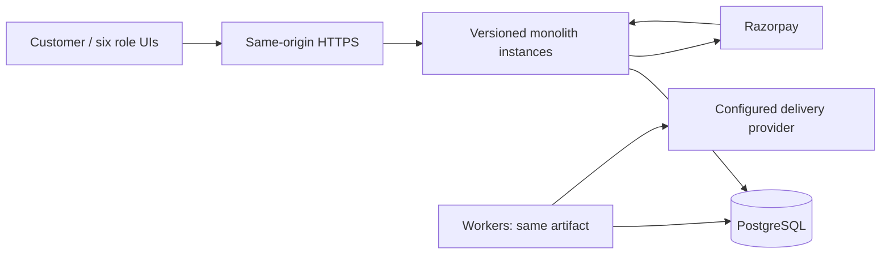

# Initial architecture decision record — 2026-11-05

Status: implementation design; not a release approval.

## Repository assessment
Only AGENTS.md, prompt.md and the complete frontend/backend specifications plus IDE metadata existed. No application, migrations, dependencies, tests, infrastructure or configured integrations were present. Existing staged user changes are preserved. AGENTS.md ends mid-payment section; its available text was read in full. Original earlier BE/BR documents mentioned by the backend spec are not present; no coverage of those missing originals is claimed.

## Confirmed decisions
India/INR, venue-local IANA time zones, modular monolith, Clean/Hexagonal architecture, 17 internal modules, Razorpay, exactly Light and Dark. No fabricated commercial data. Test fixtures only in isolated test databases. Final prompt overrides any microservice requirement.

## ADR-001 Stack and deployment
TypeScript, Node LTS, Fastify transport, explicit PostgreSQL SQL adapters, React/Vite UI. Explicit SQL makes lock order and affected-row checks reviewable. PostgreSQL is the sole transactional authority. One backend artifact serves HTTP and worker processes; no internal HTTP. Database schemas isolate module ownership. Composition root wires ports. Domain has no external imports. React is separate presentation code, served from the same origin. Sites Worker hosting was evaluated but its runtime constraints do not fit the chosen container/PostgreSQL architecture. No production release until incomplete acceptance scope is closed.

## Module ownership
- **identity**: Accounts, verified identifiers, OTP, sessions, MFA, grants.
- **profiles**: Preferences, consent, favorites, privacy requests.
- **providers**: Organizations, membership, onboarding, agreements.
- **cinema**: Movie metadata, show programming.
- **events**: Event metadata, sessions, attendee schemas.
- **sports**: Teams, competitions, fixtures, pass definitions.
- **venues**: Locations, venues, gates, immutable seating versions.
- **catalog**: Approved public projections, search, collections.
- **inventory**: Occurrence sales gates, seat ownership, pools, holds, allocation.
- **pricing**: Exact INR quotes, promotions, fees, taxes.
- **bookings**: Orders, snapshots, bookings, orchestration.
- **payments**: Provider orders, attempts, inbox, refunds, reconciliation.
- **ticketing**: Tickets, token versions, entitlements, transfers, admissions.
- **notifications**: Delivery requests, templates, attempts.
- **finance**: Balanced journals, liabilities, settlements, payouts.
- **support**: Cases, approvals, controlled administration.
- **reporting**: Audit, exports, rebuildable reporting.

## Transactions and concurrency
Inventory owns occurrence sales state, unique occurrence-seat current records, capacity pools and historical reservation items. Lock occurrence then sorted resource identities; all requested components succeed or rollback. Database time controls expiry. Old expiry jobs carry reservation identity/version. Confirmation consumes inventory, writes booking and outbox in one explicit unit of work through public ports. No external request inside a transaction. Amounts are integer paise. Retry only SQLSTATE 40001/40P01, bounded, same idempotent command. Fingerprints reject changed payloads. Identical retries return original result without extending expiry.

General admission uses a shared pool across offering categories; passes enumerate all pool/seat components and reserve atomically. Expired holds are excluded under locks even without cleanup. Late captures attempt original inventory only, atomically; failure records a refund obligation, never substitutes seats. Refund commitments lock captured-payment aggregate. Admissions lock entitlement and enforce remaining allowance. Cancellation/transfer/admission share entitlement locks; occurrence disruption takes occurrence gate lock before booking locks.

## State transitions
Provider: draft → submitted → review → changes_requested/approved/rejected → suspended/closed. Listing: draft → review → approved → published → suspended/archived. Occurrence lifecycle and sales state remain distinct. Reservation: active → consumed/released/expired. Booking: pending_payment → confirming → confirmed/failed/expired; confirmed → partially_cancelled/cancelled. Capture history is immutable; refund state is separate. Tickets: valid → revoked/replaced/expired; admission is a count/history, not ticket validity. Payment: created/pending/authorized/captured/failed/unknown. Refund/payout: requested → approved → submitted → processing → succeeded/failed/unknown; unknown requires reconciliation before retry.

Every implemented transition must have tests for actor, preconditions, locks, durable effects, retries and recovery. Unimplemented transitions remain pending in coverage, not implied by this design.

## Authorization and threat model
Anonymous: published discovery only. Customer: own profile/holds/bookings/cases. Provider: verified membership + explicit tenant/resource scope. Moderator: review grants, cannot grant own elevated access. Support: minimum customer context, no raw financial secrets. Finance: separate initiator/approver where configured. Scanner: occurrence and gate assignment plus current session/MFA. All sensitive queued operations and downloads recheck grants. UI hints never authorize execution.

Threats: IDOR/tenant leaks (query scope and execution authorization); oversell/replay (locks and durable uniqueness); forged payment (trusted association and HMAC); stored XSS (text rendering); CSRF (same-origin, cookie policy and origin validation); OTP brute force (cryptographic material, database rate limits); leaked tokens (hash opaque session/ticket tokens, no URL tokens); unsafe exports (scoped jobs and formula escaping). Secrets stay environment/secret-store only; private responses no-store.

## Proposed defaults and blockers
Development-only hold 300 seconds, max 8 items; production requires approved policy versions. Cancellation deductions, taxes, fees, commissions, settlement timing, transfer/re-entry and retention remain unresolved commercial policies, not silently activated defaults. OTP provider, Razorpay live credentials/webhook routing, payout product eligibility, licensed media/catalog, supplier contracts, hosting/domain and spending authorization are external dependencies. No test-mode payment exception is assumed. No live financial action authorized by this design.

## Personas, journeys and planned routes
Customer: /explore, /movies, /events, /sports, /listing/:id, /occurrence/:id, /checkout/:id, /bookings, /bookings/:id, /profile, /favorites, /notifications, /help, /cases/:id.
Cinema: /partner/cinema; organizer: /partner/organizer; onboarding /partner/onboarding; shared organization, venue, seating, catalog, schedule, imports, reporting and settlements subroutes.
Admin: /admin/approvals, /admin/catalog, /admin/policies, /admin/jobs, /admin/audit.
Support/finance: /operations/cases, /operations/payments, /operations/refunds, /operations/ledger, /operations/settlements.
Admission: /scanner with assignment selection, camera/manual input and server outcome.
Each route requires loading, empty, forbidden, conflict, pending, failure, offline and success behavior where relevant. This is a screen inventory, not a claim of implemented routes.

## API/event conventions
/api/v1, UUID identifiers, structured code/message/requestId errors, serverTime/freshness/version, bounded cursor pagination. Mutations use idempotency keys where retry-sensitive. Public events carry eventId/type/version/occurredAt/aggregateId; exclude OTP/card/ticket secrets. Outbox/inbox unique event identity, worker lease token, bounded retries, dead letters and authorized replay.

## Six pillars and proposed SLOs
Operational excellence: reproducible CI, request IDs, health/readiness, queue age and deployment runbooks. Security: least privilege, secret store, tenant tests. Reliability: locks, outbox, reconciliation, backup restoration. Performance: bounded queries/indexes and measured load. Cost: small initial app/worker footprint, budgets before cloud creation. Sustainability: batch expiry, no idle polling loops without backoff, retention-controlled storage.
Proposed (unverified): 99.9% API monthly availability, read p95 <300ms, reservation p95 <750ms at 100 concurrent users, RPO 5min, RTO 60min. No achieved measurement yet.

## Implementation and validation sequence
1. Foundation, boundaries, migrations, identity and themes.
2. Provider/venue/catalog publication and discovery.
3. Atomic inventory, pricing and checkout.
4. Razorpay capture/reconciliation, ledger and durable fulfillment.
5. Ticket/admission, cancellation/refund/transfer.
6. All operational portals and detailed enhancements.
7. Concurrency, tenant/security, browser/accessibility, migration, restart, load and restore evidence.
8. Authorized staging deployment, HTTPS/webhooks, smoke and live evidence.

## Recovery/deployment plan
Build immutable artifact; back up DB; apply forward compatible migrations under advisory lock; deploy one instance; check readiness; expand; keep old artifact until smoke tests pass. Roll back application only while schema remains compatible. Restore into isolated database and check inventory/ledger before switching traffic. Drain HTTP; stop acquiring worker leases; allow active transactions to finish. Unknown financial outcomes always reconcile, never blindly resubmit.
